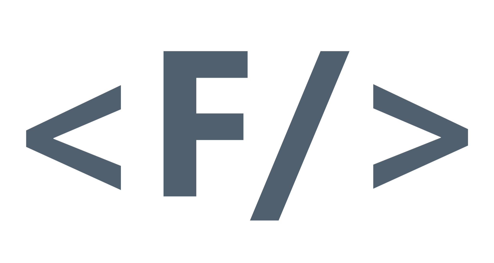
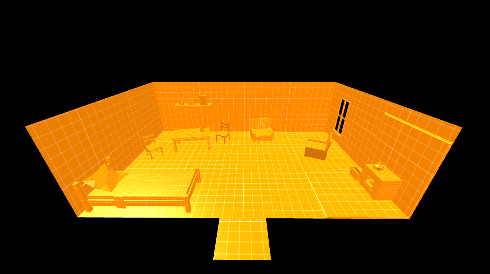

<div align="center">



# FountEngine

**Custom game engine written in C++26 with DirectX 11**

[](https://opensource.org/licenses/MIT)
[](https://en.wikipedia.org/wiki/C%2B%2B26)
[](https://en.wikipedia.org/wiki/DirectX)
[](#)
[](#)

</div>

## About

FountEngine is a custom game engine built from scratch using DirectX 11 as the
render backend. Its architecture is inspired by Source 2 and it ships with its
own render pipeline. Files use custom extensions such as `.fntpk`, `.fntmdl`,
`.fnttex`, etc.

## Architecture

FountEngine uses a subsystem-based architecture. All engine services—such as `CLogSystem`, 
`CInputSystem`, and `CResourceSystem`—are global subsystems managed by `CSystemManager`. 
Each subsystem follows a strict lifecycle (initialization, per-frame update, shutdown) 
and is exposed through a raw global pointer (`g_pXxxSystem`) for direct, low-cost access.

### Core Subsystems

- **`CLogSystem`** — console and file logging with leveled macros.
- **`CInputSystem`** — keyboard and mouse polling with edge detection.
- **`CFileSystem`** — physical and packed (`.fntpk`) file access.
- **`CResourceSystem`** — reference-counted resource cache.
- **`CEntitySystem`** — slot-based entity pool with handle safety.

## Requirements

The following tools are required to build FountEngine:

- **Visual Studio 2026** (v145 toolchain)
- **Windows 10 SDK**
- **DirectX 11** (included in the Windows SDK)

> [!NOTE]
> The project was originally developed for Visual Studio 2022. If you are using
> an older version, change the toolchain in the project settings.

## Build

1. Clone the project to local storage.

```bash
git clone https://github.com/ImHartash/FountEngine.git
```

2. Open the solution file (`FountEngine.sln`) in Visual Studio.
3. Select configuration (`Debug`/`Release`) and platform (`x64`).
4. Build the solution (**Build → Build Solution**, or <kbd>Ctrl</kbd>+<kbd>Shift</kbd>+<kbd>B</kbd>).
5. Pack game files, or move them to the `game/resources/` folder next 
to the `.exe` file.

## Usage Examples

Creating an entity:

```cpp
CCubeEntity* pCube = g_pEntitySystem->CreateEntity<CCubeEntity>();
// OnSpawn() runs automatically and resolves its model/material resources.
```

Loading a resource explicitly:

```cpp
CResourceHandle hModel = g_pResourceSystem->LoadResource("models/test_cube.fntmdl");
CModelResourceData* pModel = g_pResourceSystem->GetResource<CModelResourceData>(hModel);
```

Mounting a package before reading from it:

```cpp
g_pFileSystem->MountPakFile("game.fntpk"); // relative to game/resources/
```

## FountEngine SDK

The engine works only with custom binary formats. To convert a common format to a custom one, 
you need to use the [FountEngine SDK](https://github.com/ImHartash/FountEngine_SDK). 
The main common formats supported by the SDK are:

- `.obj` → `.fntmdl`
- `.png`, `.jpg`, etc. → `.fnttex`
- `.txt` → `.fntmat` (requires mapping)
- `folder` → `.fntpk`

> [!NOTE]
> For easier access to the converters, we recommend using the SDK Tool, which is available on the 
> Downloads page on the SDK's GitHub page.

## Screenshot

<div align="center">



<sub>Current demo — see <a href="https://github.com/ImHartash/FountEngine/releases">Releases</a></sub>

</div>

## Contacts

-  [@FountEngine](https://x.com/FountEngine)
-  [@ImHartash](https://github.com/ImHartash)


**Issues:** [github.com/ImHartash/FountEngine/issues](https://github.com/ImHartash/FountEngine/issues)

<div align="center"><sub>© 2026 ImHartash · MIT License</sub></div>